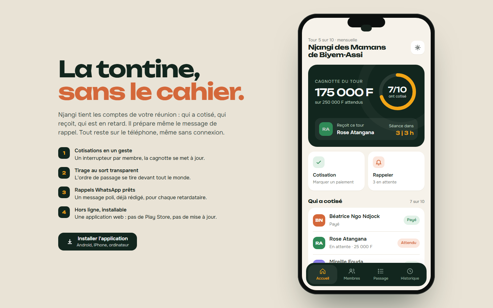
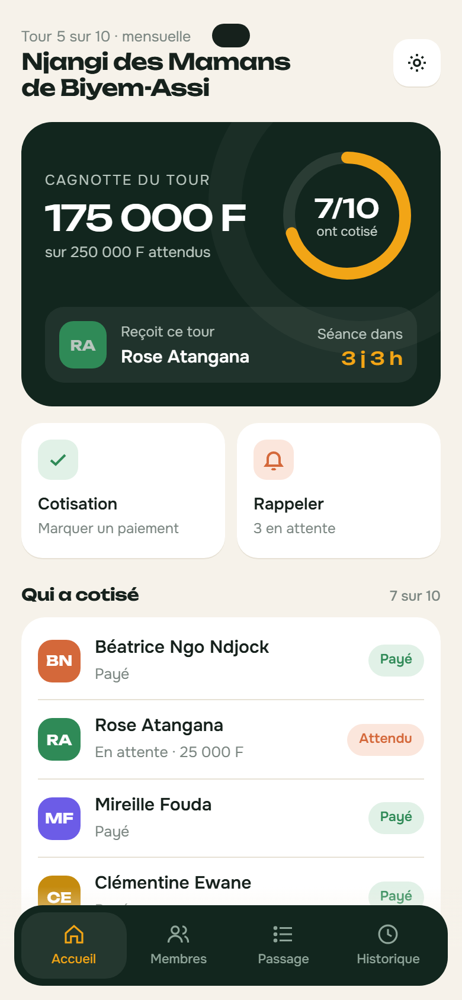

# Njangi

**Application mobile · PWA** — Application mobile de gestion de tontine : cotisations, cagnotte, ordre de passage, tirage au sort animé, rappels WhatsApp, pénalités et historique. Installable et 100 % hors ligne.

**Démo en ligne : [https://lordlennyx.github.io/njangi-pwa/](https://lordlennyx.github.io/njangi-pwa/)**

Spot de présentation (30 s) : [media/spot-30s.mp4](https://lordlennyx.github.io/njangi-pwa/media/spot-30s.mp4)

## Ce que le projet montre

- Progressive Web App : manifeste, icônes, service worker, installation Android / iPhone / ordinateur
- Fonctionne sans réseau, données conservées sur l'appareil
- Cotisations par interrupteur, pénalité automatique après l'heure de la séance, anneau de progression
- Tirage au sort des tours restants façon machine à sous, réordonnancement manuel
- Message de rappel pré-rédigé, envoi direct par WhatsApp ou copie
- Remise de la cagnotte animée, historique et statistiques de ponctualité

## Réalisation

- **Stack :** HTML, CSS, JavaScript natif, Service Worker, Web App Manifest
- **Typographies :** Unbounded, Onest
- **Évolutions possibles :** synchronisation Firebase / Supabase, paiement Orange Money et MTN MoMo, version Flutter

| Bureau | Mobile |
|---|---|
|  |  |

---

Client et contenus fictifs, créés pour la démonstration. Conception, design et développement : **Njundiyimun Béchard** — [github.com/LordLennyx](https://github.com/LordLennyx)
